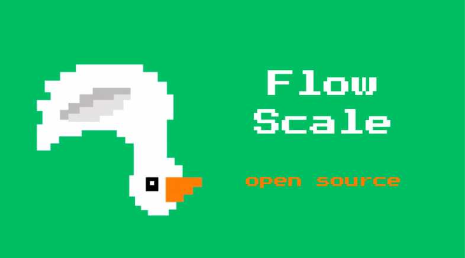

<p align="center">
  
</p>

# FlowScale

FlowScale makes windowed games look sharper and play smoother on Windows. It upscales the game window to your full screen and can generate extra frames in between the real ones, so a game running at 60 FPS can show 120.

It's free, written in Rust, and licensed MIT or Apache-2.0.

**[Download the latest release](https://github.com/oqpz/flowscale/releases/latest)** · Windows 10 or 11 · website: [flowscale.lol](https://flowscale.lol)

## Quick start

1. Set your game to **Windowed** or **Borderless** (not exclusive fullscreen).
2. Open FlowScale and pick a preset, for example *Smooth 2x + FlowSharp*.
3. Press **Scale** (or `Ctrl+Alt+S`) and click into the game within 5 seconds.

Use **Log** in the top bar to see captured vs generated FPS, dropped frames and GPU time for the current run.

## What it does

- **Upscaling.** FlowSharp, FSR 1, NIS, SGSR, Anime4K, xBR, bicubic and integer scaling.
- **Frame generation.** FlowGen 3 doubles (or more) your frame rate with a fixed multiplier, or holds a target FPS in Adaptive mode. FlowGen 2 and 1 are simpler fallbacks.
- **Capture.** DXGI (fastest), Windows Graphics Capture (works with HDR and borderless edge cases) or GDI as a last resort.
- **Per-game profiles.** Match a game's .exe and FlowScale can start scaling it automatically.
- **Small stuff.** Tray icon, global hotkey, FPS overlay, cursor scaling, HDR output.

Tip: if the Log shows generation time near the frame budget, lower **Flow scale** (100% → 50%). It roughly quarters the GPU cost of frame generation.

## Build from source

You need the Rust MSVC toolchain, Node.js and the Windows SDK (for `fxc.exe`).

```powershell
cd apps/flowscale-ui
npm install
npm run build
cd ../..
cargo build --release
```

The app ends up at `target\release\flowscale.exe`. The UI is embedded in it, so that one file plus `runtime\` (only needed for the CPU Vulkan path) is all you ship.

## Project layout

| Folder | What's in it |
|---|---|
| `apps/flowscale-ui` | The settings app (React + TypeScript), embedded into the exe |
| `crates/flowscale-app` | The Windows host: window, tray, hotkey, talks to the UI |
| `crates/flowscale-core` | The engine that runs a scaling session |
| `crates/flowscale-capture` | DXGI, WGC and GDI capture |
| `crates/flowscale-gpu` | D3D11 shaders for upscaling and frame generation |
| `crates/flowscale-config` | Settings, profiles and frame pacing |
| `crates/flowscale-overlay` | The click-through output window |
| `crates/flowscale-abi`, `flowscale-cli`, `flowscale-vulkan` | C API, command-line tool, CPU fallback |

More detail: [architecture](docs/ARCHITECTURE.md), [pipeline and pacing](docs/PIPELINE_AND_PACING.md), [C API](docs/NATIVE_ABI.md), [UI ↔ host messages](apps/flowscale-ui/IPC_CONTRACT.md). Want to help? See [CONTRIBUTING.md](CONTRIBUTING.md).
